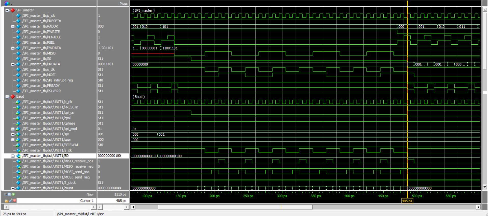
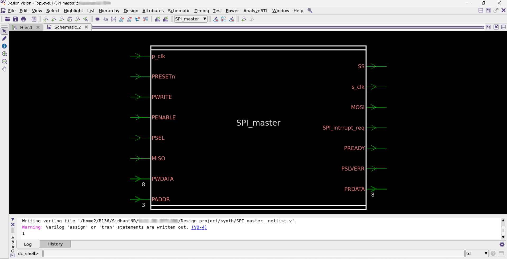

# APB-Based SPI Master IP Core

A modular SPI Master IP Core designed using **Verilog HDL**, featuring an **AMBA APB-based programming interface**. The project integrates APB register access, SPI clock generation, slave-select control, and serial data transmission and reception.

**Tools Used:** ModelSim | Synopsys VC SpyGlass | Synopsys Design Compiler | Synopsys Design Vision

---

## Table of Contents

1. [Project Overview](#project-overview)
2. [Architecture](#architecture)
3. [Top-Level Interface](#top-level-interface)
4. [RTL Modules](#rtl-modules)
5. [APB Register Map](#apb-register-map)
6. [SPI Configuration](#spi-configuration)
7. [Baud Rate Calculation](#baud-rate-calculation)
8. [Simulation and Verification](#simulation-and-verification)
9. [RTL Lint Analysis](#rtl-lint-analysis)
10. [Synthesis](#synthesis)
11. [Repository Structure](#repository-structure)
12. [Tools and Technologies](#tools-and-technologies)
13. [Future Improvements](#future-improvements)
14. [References](#references)
15. [Author](#author)

---

## 1. Project Overview

This project implements an SPI Master IP Core controlled through an APB interface.

The APB interface provides access to configuration, baud-rate, status, and data registers. The SPI Master uses these registers to configure and control serial communication with an external SPI peripheral.

### Key Features

- APB-based register interface.
- SPI Master functionality.
- Programmable baud-rate generation.
- Configurable clock polarity (CPOL).
- Configurable clock phase (CPHA).
- MSB-first and LSB-first data transmission.
- Serial data transmission through MOSI.
- Serial data reception through MISO.
- Programmable slave-select control.
- Interrupt request generation.
- Modular RTL architecture.

### Project Status

The project includes:

- RTL implementation and top-level integration.
- Individual and top-level simulation testbenches.
- ModelSim simulation results.
- Synopsys VC SpyGlass lint analysis.
- Synopsys Design Compiler synthesis.
- Synthesized gate-level Verilog netlist.
- Synopsys Design Vision schematic views.

The project has undergone simulation, linting, and synthesis. Further protocol-level verification and timing analysis remain important before production sign-off.

---

## 2. Architecture

The design consists of four functional blocks integrated through the top-level SPI Master module.

### Block Diagram

```text
                       APB MASTER
                           |
                   APB INTERFACE
                           |
                           v
                  +----------------+
                  |                |
                  |   APB_SLAVE    |
                  |                |
                  | CR1 / CR2      |
                  | BR / SR / DR   |
                  |                |
                  +----------------+
                     |          ^
                     |          |
              Configuration     |
                     |          |
          +----------+----------+----------+
          |                                 |
          v                                 v
 +-------------------+             +-------------------+
 |                   |             |                   |
 |  BAUD GENERATOR   |             |   SLAVE SELECT    |
 |                   |             |                   |
 |  SPI Clock        |             |   SS Control      |
 |  Edge Detection   |             |   Transfer Timing |
 |                   |             |                   |
 +-------------------+             +-------------------+
          |                                 |
          +---------------+-----------------+
                          |
                          v
                 +-------------------+
                 |                   |
                 | SHIFT REG BLOCK   |
                 |                   |
                 | MOSI Transmission |
                 | MISO Reception    |
                 |                   |
                 +-------------------+
                     |          ^
                     |          |
                    MOSI       MISO
                     |          |
                     +----------+
                          |
                    SPI PERIPHERAL
```

### Design Flow

```text
RTL Design
    |
    v
ModelSim Simulation
    |
    v
Functional Waveform Analysis
    |
    v
Synopsys VC SpyGlass
    |
    v
RTL Lint Analysis
    |
    v
Synopsys Design Compiler
    |
    v
Logic Synthesis
    |
    v
Gate-Level Netlist
    |
    v
Synopsys Design Vision
    |
    v
Schematic Inspection
```

---

## 3. Top-Level Interface

**Top-Level Module:** `SPI_master`

### Input Signals

| Signal | Width | Description |
|---|---:|---|
| `p_clk` | 1 bit | APB system clock |
| `PRESETn` | 1 bit | Active-low reset |
| `PADDR` | 3 bits | APB register address |
| `PWRITE` | 1 bit | APB write control |
| `PENABLE` | 1 bit | APB enable phase |
| `PSEL` | 1 bit | APB peripheral select |
| `PWDATA` | 8 bits | APB write data |
| `MISO` | 1 bit | Master In Slave Out |

### Output Signals

| Signal | Width | Description |
|---|---:|---|
| `SS` | 1 bit | Active-low SPI slave select |
| `PRDATA` | 8 bits | APB read data |
| `s_clk` | 1 bit | Generated SPI clock |
| `MOSI` | 1 bit | Master Out Slave In |
| `SPI_intrrupt_req` | 1 bit | SPI interrupt request |
| `PREADY` | 1 bit | APB ready signal |
| `PSLVERR` | 1 bit | APB slave error signal |

---

## 4. RTL Modules

The design is divided into five Verilog modules.

### 4.1 APB Slave

**File:** `rtl/APB_slave.v`

The APB Slave module provides the register interface between the APB master and SPI controller.

Responsibilities:

- APB transaction handling.
- Register read and write operations.
- SPI configuration.
- Baud-rate configuration.
- Transmit and receive data handling.
- Status flag generation.
- Interrupt request generation.

The RTL contains two state machines.

**APB State Machine**

- `IDEAL`
- `SETUP`
- `ENABLE`

**SPI Operating Mode State Machine**

- `RUN`
- `WAIT`
- `STOP`

The following registers are implemented:

- Control Register 1 (CR1)
- Control Register 2 (CR2)
- Baud Rate Register (BR)
- Status Register (SR)
- Data Register (DR)

### 4.2 Baud Rate Generator

**File:** `rtl/baud_genrator.v`

The baud-rate generator generates the SPI serial clock based on the programmed prescaler values.

Responsibilities:

- Programmable SPI clock generation.
- Clock polarity handling.
- Clock phase handling.
- Transmit edge generation.
- Receive edge generation.

Generated signals:

- `s_clk`
- `MOSI_send_pos`
- `MOSI_send_neg`
- `MISO_receive_pos`
- `MISO_receive_neg`

### 4.3 Slave Select Controller

**File:** `rtl/slave_select.v`

This module controls the SPI slave-select signal and transfer timing.

Responsibilities:

- Active-low slave-select generation.
- SPI transfer timing.
- Transfer counter management.
- Receive-data indication.

The transfer target used in the RTL is:

\[
Target = 8 \times BD
\]

Where `BD` represents the baud-rate divisor.

### 4.4 Shift Register Block

**File:** `rtl/shift_reg_block.v`

This module handles serial data transmission and reception.

Internal registers:

- `shift_reg`: Holds the transmit data.
- `temp_reg`: Stores received serial data.

Responsibilities:

- Parallel-to-serial conversion.
- Serial-to-parallel conversion.
- MOSI data transmission.
- MISO data reception.
- MSB-first and LSB-first data handling.
- Transmit and receive timing control.

### 4.5 SPI Master Top Module

**File:** `rtl/SPI_master.v`

The top-level module integrates all four functional modules.

Module instances:

| Instance | Module |
|---|---|
| UNIT1 | `baud_genrator` |
| UNIT2 | `slave_select` |
| UNIT3 | `shift_reg_block` |
| UNIT4 | `APB_slave` |

It connects the APB register interface with the SPI clock generator, slave-select controller, and shift-register datapath.

---

## 5. APB Register Map

The APB address bus is 3 bits wide.

| Address | Register | Access |
|---|---|---|
| `3'b000` | CR1 | Read / Write |
| `3'b001` | CR2 | Read / Write |
| `3'b010` | BR | Read / Write |
| `3'b011` | SR | Read |
| `3'b101` | DR | Read / Write |
| `3'b100` | Reserved | Read returns zero |
| `3'b110` | Reserved | Read returns zero |
| `3'b111` | Reserved | Read returns zero |

### Control Register 1 (CR1)

| Bit | Signal | Description |
|---:|---|---|
| 7 | SPIE | SPI interrupt enable |
| 6 | SPE | SPI enable |
| 5 | SPTIE | SPI transmit interrupt enable |
| 4 | MSTR | Master mode select |
| 3 | CPOL | Clock polarity |
| 2 | CPHA | Clock phase |
| 1 | SSOE | Slave-select output enable |
| 0 | LSBFE | LSB-first enable |

### Control Register 2 (CR2)

| Bit | Signal | Description |
|---:|---|---|
| 4 | MODFEN | Mode fault enable |
| 1 | SPISWAI | SPI wait mode control |

The RTL uses the following write mask:

```verilog
CR2_mask = 8'b00011011;
```

### Baud Rate Register (BR)

| Bits | Signal | Description |
|---|---|---|
| `[6:4]` | SPPR | Baud-rate prescaler |
| `[2:0]` | SPR | Baud-rate rate selection |

The RTL uses the following write mask:

```verilog
BR_mask = 8'b01110111;
```

### Status Register (SR)

The status register is assigned as follows in the RTL:

```verilog
SR <= {spif, 1'b0, sptef, modf, 4'b0};
```

Status signals:

- `SPIF`: SPI transfer complete indication.
- `SPTEF`: SPI transmit buffer empty indication.
- `MODF`: Mode fault indication.

The exact flag generation and clearing behavior should be validated against the intended SPI register specification.

---

## 6. SPI Configuration

The design includes configurable SPI operating parameters.

| Parameter | Description |
|---|---|
| CPOL | SPI clock polarity |
| CPHA | SPI clock phase |
| LSBFE | Bit transmission order |
| MSTR | Master mode selection |
| SPE | SPI enable |
| SPISWAI | Wait mode control |

### SPI Operating Modes

| SPI Mode | CPOL | CPHA |
|---|---:|---:|
| Mode 0 | 0 | 0 |
| Mode 1 | 0 | 1 |
| Mode 2 | 1 | 0 |
| Mode 3 | 1 | 1 |

All four combinations should be included in the functional verification test plan.

---

## 7. Baud Rate Calculation

The baud-rate divisor is calculated using the programmed SPPR and SPR values.

\[
BD = (SPPR+1)\times 2^{(SPR+1)}
\]

Where:

- `SPPR` = Prescaler field.
- `SPR` = Rate selection field.
- `BD` = Baud-rate divisor.

The baud-rate generator uses the divisor to control SPI clock timing.

The slave-select controller uses the following transfer target:

\[
Target = 8 \times BD
\]

The actual SPI clock frequency depends on the input system clock and the generated clock-divider behavior.

---

## 8. Simulation and Verification

Functional simulation was performed using **ModelSim**.

Individual testbenches are provided for the functional blocks and top-level integration.

### Testbench Files

| Testbench | Description |
|---|---|
| `tb/APB_slave_tb.v` | APB Slave verification |
| `tb/baud_genrator_tb.v` | Baud-rate generator verification |
| `tb/slave_select_tb.v` | Slave-select controller verification |
| `tb/shif_reg_block_tb.v` | Shift-register verification |
| `tb/SPI_master_tb.v` | Top-level SPI Master verification |

### Top-Level Simulation Result

The following waveform represents the integrated top-level SPI Master simulation.



Individual block-level simulation result images are available in the `Results/` directory. They are retained for reference and are not embedded in this README.

### Running Simulation in ModelSim

Open ModelSim from the repository root directory.

```tcl
vlib work

vlog rtl/baud_genrator.v
vlog rtl/slave_select.v
vlog rtl/shift_reg_block.v
vlog rtl/APB_slave.v
vlog rtl/SPI_master.v

vlog tb/SPI_master_tb.v

vsim work.SPI_master_tb

add wave -r /*

run -all
```

For individual module simulations, compile the corresponding RTL file and testbench, then simulate the relevant testbench module.

### Existing Simulation Evidence

The supplied top-level transcript records:

- Successful compilation.
- Simulation reaching `$finish`.
- Zero simulation errors.
- Four warnings.

The slave-select transcript records:

- Successful compilation.
- Simulation reaching `$finish`.
- Zero simulation errors.
- One warning.

The other testbench files are included in the repository. Their results should be evaluated using their corresponding simulation logs and waveforms.

**Note:** A simulator reporting zero errors does not automatically establish complete functional correctness. Self-checking comparisons and assertions are recommended for stronger verification.

---

## 9. RTL Lint Analysis

RTL linting was performed using **Synopsys VC SpyGlass**.

### Lint Configuration

**Script:** `lint/SPI_master.tcl`

**Report:** `lint/report_SPI_master.txt`

**Top Module:** `SPI_master`

**Lint Goal:** `lint_rtl`

**Tool Version:** `X-2025.06`

### SpyGlass Lint Summary

| Stage | Fatals | Errors | Warnings | Infos |
|---|---:|---:|---:|---:|
| DESIGN_READ | 0 | 0 | 1 | 0 |
| LANGUAGE_CHECK | 0 | 0 | 0 | 1 |
| STRUCTURAL_CHECK | 0 | 0 | 0 | 10 |
| **Total** | **0** | **0** | **1** | **11** |

### Lint Report Interpretation

The supplied lint report identifies:

- Zero fatal violations.
- Zero errors.
- One warning.
- Eleven informational messages.

The warning is:

`DB_CANT_LOAD`

The report identifies an invalid or empty link-library configuration in the lint setup.

The informational messages include:

- `RegInputOutput-ML`
- `ReportPortInfo-ML`

The library configuration should be corrected and SpyGlass rerun before claiming a warning-free lint result.

---

## 10. Synthesis

Logic synthesis was performed using **Synopsys Design Compiler (DC Ultra)**.

The synthesis script is:

```text
synth/SPI_master.tcl
```

### Synthesis Flow

The Design Compiler script performs the following operations:

1. Clears previously loaded designs.
2. Configures the search path.
3. Specifies the target and link libraries.
4. Analyzes the Verilog RTL files.
5. Elaborates the top-level module.
6. Links the design.
7. Checks the design.
8. Executes `compile_ultra`.
9. Writes the synthesized Verilog netlist.

### Synthesis Output

The synthesized netlist is available at:

```text
synth/SPI_master__netlist.v
```

The generated netlist identifies:

- Tool: Synopsys DC Ultra.
- Version: X-2025.06.
- Top-level design: `SPI_master`.

### Top-Level Synthesized Schematic

The synthesized design was inspected using **Synopsys Design Vision**.

The following image shows only the outer top-level `SPI_master` module schematic.



The schematic shows the top-level module boundary and its APB/SPI input and output ports.

**Note:** The schematic demonstrates the synthesized top-level design interface. It does not establish area, timing closure, or power performance.

The repository snapshot does not include the technology library, timing constraints (SDC), or complete Design Compiler area/timing/QoR reports. Therefore, quantitative area, delay, power, and timing-closure claims are not made here.

---

## 11. Repository Structure

```text
APB-interface-SPI-master-IP-core-RTL-design/
│
├── rtl/
│   ├── APB_slave.v
│   ├── SPI_master.v
│   ├── baud_genrator.v
│   ├── shift_reg_block.v
│   └── slave_select.v
│
├── tb/
│   ├── APB_slave_tb.v
│   ├── SPI_master_tb.v
│   ├── baud_genrator_tb.v
│   ├── shif_reg_block_tb.v
│   └── slave_select_tb.v
│
├── sim/
│   ├── APB_slave/
│   ├── SPI_master/
│   ├── baud_genrator/
│   ├── shif_reg_block/
│   └── slave_select/
│
├── lint/
│   ├── SPI_master.tcl
│   ├── report_SPI_master.txt
│   └── Makefile.txt
│
├── synth/
│   ├── SPI_master.tcl
│   └── SPI_master__netlist.v
│
├── Results/
│   ├── APB_slave_result.png
│   ├── SPI_master_result.png
│   ├── baud_genrator_result.png
│   ├── shift_register_result.png
│   ├── slave_select_result.png
│   │
│   └── Synthesis/
│       └── top_level_spi_master.png
│
├── Reference_materials/
│   ├── ARM_AMBA3_APB.pdf
│   ├── ARM_AMBA3_APB.txt
│   ├── S12SPIV3.pdf
│   └── S12SPIV3.txt
│
├── lib/
│
├── LICENSE
└── README.md
```

The `Results/` directory contains individual block-level simulation images and the top-level synthesis schematic. Only the integrated simulation waveform and outer synthesis schematic are embedded in this README.

---

## 12. Tools and Technologies

| Category | Tool / Technology |
|---|---|
| Hardware Description Language | Verilog HDL |
| Functional Simulation | ModelSim |
| Waveform Analysis | ModelSim Wave |
| RTL Linting | Synopsys VC SpyGlass |
| Logic Synthesis | Synopsys Design Compiler |
| Synthesis Schematic | Synopsys Design Vision |
| Version Control | Git |
| Repository Hosting | GitHub |

---

## 13. Future Improvements

The following improvements are planned for strengthening the IP implementation and verification.

- Correct and rerun the SpyGlass library configuration.
- Verify APB setup and access phase behavior.
- Validate PREADY and PSLVERR behavior.
- Verify SPI enable and operating-mode controls.
- Validate SPIF, SPTEF, and MODF status flag behavior.
- Verify all four CPOL/CPHA combinations.
- Verify MSB-first and LSB-first transmission and reception.
- Add self-checking testbenches and assertions.
- Verify zero, maximum, and alternating data patterns.
- Add synthesis area and timing reports.
- Perform timing analysis using appropriate SDC constraints.
- Improve simulation and synthesis documentation.

---

## 14. References

The following reference documents were used during the project:

1. **ARM AMBA 3 APB Protocol Specification**  
   Reference for APB bus architecture and transaction behavior.

2. **Motorola / Freescale SPI Block Guide (S12SPIV3)**  
   Reference for SPI configuration, register organization, and operation.

The reference documents remain subject to their original ownership and licensing terms.

---

## 15. Author

**Sidhant Borkar**

B.Tech – Electronics & Telecommunication Engineering

- GitHub: [sidhantborkar16](https://github.com/sidhantborkar16)
- Portfolio: [sidhantborkar.vercel.app](https://sidhantborkar.vercel.app/)

---

**Project:** APB-Based SPI Master IP Core  
**HDL:** Verilog  
**Simulation:** ModelSim  
**Lint:** Synopsys VC SpyGlass  
**Synthesis:** Synopsys Design Compiler
